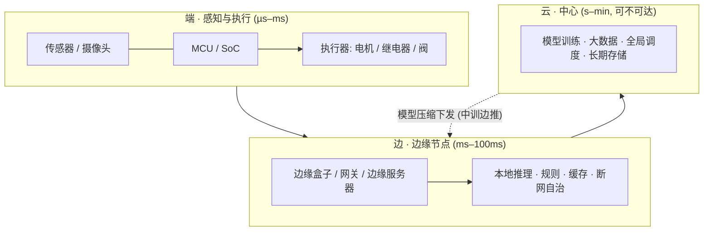

# 前沿领域探索

**已实现的市场 · 正在探索的前沿 · 边缘计算的角色**

---

## 阅读说明

本报告只讨论**公开市场、公开技术与产业趋势**，不涉及任何自建实验项目。

所有事实标注来源类型：

| 标注 | 含义 | 用法 |
| --- | --- | --- |
| **【公开报道】** | 企业公告、行业协会、主流媒体的一手报道 | 事实为主 |
| **【机构口径】** | 市场研究机构测算，不同机构口径差异大 | 只作量级参考 |
| **【技术共识】** | 工程界的通用做法与公开技术边界，非某一家之言 | 用于解释"为什么必须这样" |

数据截至 **2026 年 10 月**。

---

## 0. TL;DR

### 三句话

1. **"让电机按设定值精确转动"这件事，在家电、汽车、工业机器人、无人机与电动工具里早已完成产业化。**它已经"隐身"：沉进能效法规和产品说明书，客户按省电费与可靠性买单，不按技术买单。
2. **仍在前沿的是人形机器人关节、灵巧手、航空电动化、轴向磁通、无稀土电机、宽禁带驱动与具身智能。**共同特征是：能演示、已开示范线或拿到首个认证，但**成本曲线、行业标准和安全范式尚未确定**。
3. **把这些技术真正送进现场的那根"神经"是边缘计算**——算力必须下沉到离电机只有几毫秒的地方。它现在的规模信号非常明确：中国 2026 年市场预计破 1300 亿元，端侧 AI 2029 年预计达 1.2 万亿元，**而它真正的瓶颈已经不是算法，是内存价格**。

### 一张表看全局

| 领域 | 状态 | 关键数字 |
| --- | --- | --- |
| 家电变频（空调/冰洗/吸尘器） | **已实现** | 全球空调电机 87.3 亿美元；变频渗透率首破 60%；BLDC 出货占比 48% |
| 汽车（热管理/座椅/EPS/主驱） | **已实现** | 中国 BLDC 下游汽车占 41%；800V 平台 SiC 方案渗透率破 15% |
| 工业机器人 / 伺服 / AGV | **已实现** | 2025 年中国装机 35.4 万台、占全球 59%；国产份额 55% |
| 无人机 / 云台 / 电动工具 | **已实现** | 北美 BLDC 市场约 62 亿美元（数据中心风机 + 电动工具拉动） |
| 医疗设备（中低端） | **已实现** | 但航空级/医疗级高端电机进口依赖度仍 >60% |
| 人形机器人关节 / 灵巧手 | **探索中** | 2025 全球出货约 1.86 万台；2026 需求预计 3 万台；放量或在 2027–2028 |
| 航空电动化（eVTOL） | **探索中** | ENGINeUS 100 成为首个取得认证的航空电机 |
| 轴向磁通（盘式）电机 | **探索中** | 2025 年才出现首条智能示范线投产 |
| 无稀土电机 | **探索中** | 仍以学术论文为主 |
| 宽禁带驱动（GaN） | **探索中** | SiC 已上车；GaN"开始进入小批量验证，2030 年前后商业化降本" |
| 具身智能 / VLA | **探索中** | 模型已上边缘设备，安全范式与标准未定 |
| **边缘计算** | **正在规模化的枢纽** | 中国 2026 年破 1300 亿元；端侧 AI 2025→2029 从 3219 亿到 1.2 万亿元（CAGR 39.6%） |

### 时间轴（关键节拍）

| 时间 | 事件 |
| --- | --- |
| 2025 | 全球人形机器人出货约 1.86 万台；中国工业机器人装机 35.4 万台创纪录；国内首条稀土盘式电机示范线投产；中国新增 IE5 能效等级 |
| 2026 | 人形机器人需求预计 3 万台；特斯拉规划年产 100 万台 Optimus 产线（预计年底投产）；AI PC 渗透率预计过半（55%） |
| 2027–2028 | 人形机器人"真正放量"窗口；**存储卡点预计自 2027 年下半年缓解**；端侧"杀手级应用"预期破局 |
| 2030 | GaN 在电机驱动"商业化降本"的时间点；国务院目标：智能终端/智能体应用普及率超 90% |

---

## 1. 技术坐标系：把"让电机转"这件事拆成六层

讨论"实现到什么程度"，先要有一个可对齐的坐标系。把整条链条拆成六层，逐层看它的**市场形态**：

| 层 | 内容 | 市场形态 | 竞争焦点 |
| --- | --- | --- | --- |
| **L0** 电气连接 | 电源、共地、驱动板、保护 | 完全商品化，驱动板十几元到几十元 | 成本、可靠性 |
| **L1** 使能与方向 | 使能引脚、方向位、基本调速 | 任意 MCU 的标准外设能力 | 已无竞争 |
| **L2** 换相与闭环 | 编码器、PID、电流环、FOC | **技术含量与利润集中区**：从几元电调到几千元伺服 | 力矩密度、噪声、效率、控制带宽 |
| **L3** 指令与协议 | 总线、工业以太网、无线链路 | 标准林立：EtherCAT/CANopen/Modbus/私有无线 | 生态与实时性 |
| **L4** 人机交互 | 手势、语音、视觉、App | 消费化最快的层 | 体验与隐私 |
| **L5** 安全与自治 | 断网降级、功能安全、可追溯、审计 | **准入壁垒最高**：功能安全认证（如 IEC 61508/ISO 13849 体系） | 认证与责任 |

**一条贯穿全报告的判断**：**过去二十年电机控制的所有真实进步，几乎都发生在 L2。**家电变频、汽车电驱、无人机电调、工业伺服，本质上都是在不同成本约束下把 L2 做到极致——要么更便宜，要么更精确，要么更耐热。

L5 则决定了"能不能进工厂、能不能进医院、能不能载人"。

---

## 2. 人类已经实现的领域

### 2.1 判定标准

一个领域的技术要算"**已经实现**"，本报告用三条硬标准：

1. **批量出货**——不是样品，是年产百万级以上的商品；
2. **有强制标准**——能效、安全、排放法规把它写进了法律条文；
3. **维护生态完备**——有备件、有说明书、有维修网点，客户不必理解原理。

三条全中，技术即"隐身"。逐领域检查。

### 2.2 家电变频：隐身得最彻底

**【机构口径】** 2025 年全球空调电机市场 87.3 亿美元（同比 +5.2%）；**变频渗透率首次突破 60%**，BLDC 出货占比 48%，住宅空调 BLDC 占比 2026 年预计升至 55%；中国 2025 年空调电机产量超 1.2 亿台，占全球 65% 以上。[来源](https://m.gepresearch.com/86/view-1096746-1.html)

**政策端更能说明"已实现"**：欧盟要求 2026 年后新装空调电机效率不低于 **IE4**；中国 2025 年底修订标准把变频空调能效门槛**再提高 15%**；全球已有 **30 多个国家**实施电机能效强制标准，中国 2025 年 7 月新增 **IE5** 等级。

**判读**：变频空调的核心技术（三相逆变 + 转子位置估算 + 弱磁控制）已经便宜到**消费者为省电费而买、而不是为技术而买**。当一项技术靠电费差价就能自我推销时，它完成了产业化。

### 2.3 汽车：从辅助部件到主驱

**【机构口径】** 2025 年全球 BLDC 电机市场约 285 亿美元（+12.3%），预计 2030 年突破 450 亿美元（CAGR ≈ 9.6%）；中国 BLDC 2025 年产值超 680 亿元、占全球 37% 以上，下游结构为**新能源汽车 41%** / 家电 29% / 工业装备及机器人 18%；SiC 驱动方案在 800V 平台渗透率突破 15%；2025 年中国 BLDC 出口 124 亿美元、进口 87 亿美元。[来源](https://m.gepresearch.com/80/view-1080916-1.html)

汽车领域的关键词不是"能不能转"，而是**车规级可靠性验证**——这正是该报告点出的中国短板之一（另两个是高端轴承材料与精密控制算法）。

**已经产业化的细分**：电子水泵/油泵、热管理阀、座椅调节、电动尾门、EPS 转向助力、主动悬架油泵。它们的共性是**功率不大、闭环要求明确、寿命要求极高**——L2 被打磨成了标准件。

### 2.4 工业机器人与伺服：装机量最硬的证据

**【公开报道】国际机器人联合会（IFR）《World Robotics 2026》**（2026-09-24 发布）[来源](https://www.chinadaily.com.cn/a/202609/24/WS6ab4985ce4b06d4aa055ffc4.html)：

| 指标 | 2025 年数据 |
| --- | --- |
| 中国工业机器人装机量 | **35.4 万台**，同比 +20%，占全球 **59%** |
| 行业结构 | 电子电气 9.64 万台（+16%，占 27%）；汽车 7.89 万台（**+38%，创纪录**）；金属与机械 7.87 万台（+44%） |
| 国产供应商 | 装机 19.5 万台（+15%），份额 **55%**；外资供应商 +27% |
| 未来预期 | IFR 预测 2026–2029 年中国市场年均增长 **5%–10%**，远未饱和 |

IFR 同时指出，中国"十五五"规划（2026–2030）把 AI 研究重心指向**物理应用**，机器人被视为经济增长的重要驱动。

**为什么这一格是"已实现"**：协作机器人关节、AGV/AMR 驱动轮模组都已是标准货架产品；**编码器 + 电流环 + 位置环 + 工业总线**全链路成熟，价格从早年"一台伺服抵一辆车"降到批量几百元级。

### 2.5 无人机 / 云台 / 电动工具 / 消费电子

**【机构口径】** 北美 BLDC 市场约 62 亿美元，增长由数据中心冷却风机与电动工具拉动。[来源](https://m.gepresearch.com/80/view-1080916-1.html)

**已实现的技术内核**：无感 FOC 电调（ESC）——在几块钱的 MCU 上完成反电动势过零检测、六步换相、油门线性化。**这是"把 L2 做到极低成本"的典范**：不是算法简单，而是算法被压缩到能与成本共存。

### 2.6 医疗与康复：半实现

中低端已实现：输液泵、牙科手机、呼吸机风机、康复训练设备。

**【机构口径】** 但**航空级与医疗级高端电机的进口依赖度仍超过 60%**[来源](https://m.gepresearch.com/80/view-1080916-1.html)——说明这一格是"能用，但最好的一档还在别人手里"。

### 2.7 创客与教育市场

驱动板（TB6612FNG、L298N、A4988 等）与 PWM 调速是成熟商品，接线图与故障排查方法公开可得。**当一个领域的最佳实践能被写成一页接线图时，它就成熟了**——这一格的价值不在技术，而在**人才漏斗**：它是整个产业的上游入口。

### 2.8 成熟区的共同特征

| 特征 | 含义 |
| --- | --- |
| 需求被价格锚定 | 客户按"省多少钱/省多少电"买单 |
| 被法规接管 | 能效/安全标准成了准入条件 |
| L2 被封装成商品 | 闭环算法进了驱动 IC 或标准模组 |
| 故障模式公开 | 有排查清单，社区能自学 |

---

## 3. 正在探索的领域

### 3.1 判定标准

算"**正在探索**"，三条至少中一条：

1. **缺成本曲线**——只能演示，太贵或良率低；
2. **已开示范线 / 拿到首个认证，但未大规模复用**；
3. **缺标准与安全范式**——没人说清"出了事算谁的"。

### 3.2 人形机器人关节与灵巧手：最热的探索区

**供给侧【公开报道】**：2026 年 5 月，雷赛智能披露已批量供应高密度无框力矩电机、中空编码器、空心杯电机、行星与谐波关节模组，以及 21 自由度灵巧手；**2025 年无框力矩电机交付超 12 万台，同比增长 20 倍以上**；在建年产 200 万台产能。[来源](http://jnzstatic.cs.com.cn/zzb/htmlInfo/122687.html)

**需求侧【公开报道】瑞银报告**（2026 年 2 月）[来源](https://www.163.com/dy/article/KLJT265E05198NMR.html)：

- 2025 年全球人形机器人出货约 **1.86 万台**，中国企业占主导：宇树科技与智元机器人**各约 5000 台，两家合计近 1 万台，占全球半数以上**；
- 2026 年全球需求预计 **3 万台**（乐观 3.5 万台、极端 4 万台）；
- 产能布局：特斯拉规划**年产 100 万台** Optimus 产线，预计 2026 年底投产；优必选 2026 年目标 1 万台产能；波士顿动力计划 2028 年为 Atlas 建成 3 万台年产能；
- 判断：**真正的出货放量有望在 2027–2028 年集中释放**。

**【机构口径】** 人形机器人旋转关节用无框力矩电机市场给出约 **25.0% CAGR** 预测。[来源](https://dxpress.gelonghui.com/p/6460768)

**为什么仍是探索**：1.86 万台的出货量放在家电（1.2 亿台）面前是万分之一量级；关节模组的真正难点不在电机本体，而在**中空走线、编码器分辨率、力矩密度与散热**——尚未形成行业标准件。更关键的是：**"产能规划"与"实际需求"之间还隔着一个工业场景能否自主完成任务的验证期。**

### 3.3 航空电动化：刚拿到第一张入场券

**【公开报道】** 由英国 ATI 资助、Safran 开发的 **ENGINeUS 100 成为首个取得认证的航空电机**。[来源](https://www.ati.org.uk/news-events/news/safrans-ati-funded-engineus-100-electric-motor-achieves-certification-first/)

航空的瓶颈从来不是"能不能转"，而是**适航认证**。首张证书意味着路径被打通，但离机队规模部署仍远——这一格的护城河是 L5，不是 L2。

### 3.4 轴向磁通（盘式）电机：停在示范线

**【公开报道】** 2025 年 8 月，国内首条稀土盘式电机智能示范线投产（央广网）；2025 年 12 月，星汉动力完成千万元级融资推动产业化（人民网重庆）。[央广网](https://nm.cnr.cn/gstjnmg/20250808/t20250808_527308759.shtml) · [人民网](http://cq.people.com.cn/n2/2025/1204/c365412-41432217.html)

出现"示范线 + 早期融资"是典型的探索期信号：**技术路线被认可，但产能与良率尚未被验证**。轴向磁通的吸引力在于功率密度与扁平结构，难点在制造工艺与散热。

### 3.5 无稀土 / 少稀土电机：还在论文里

**【公开报道】** 相关研究目前仍以 IEEE 论文为主（开关磁阻、铁素体辅助同步磁阻等方向）。[来源](https://xplorestaging.ieee.org/document/11259518)

**【机构口径】佐证**：稀土永磁价格 2025 年同比回落约 15%[来源](https://m.gepresearch.com/80/view-1080916-1.html)——价格回落会**削弱**无稀土路线的紧迫性。这是它长期停留在学术阶段最现实的商业原因：**不是做不到，而是没必要**。

### 3.6 宽禁带半导体：SiC 已上车，GaN 还在门口

**【机构口径】** SiC 驱动 BLDC 在 800V 平台渗透率已破 15%（属于"正在实现"）；而 GaN 在电机驱动中"**开始进入小批量验证，2030 年前后商业化降本**"。[来源](https://m.gepresearch.com/80/view-1080916-1.html)

**技术意义**：宽禁带器件把开关频率提高一个量级，从而同时改善**电流环带宽**、**噪声与转矩脉动**——直接作用于 L2。这也是为什么它被视为下一代伺服与电驱的关键变量。

### 3.7 具身智能与 VLA：模型已上边缘，范式未定

**【公开报道】** 视觉-语言-动作（VLA）模型正在向边缘设备迁移，用于实时机器人感知。[来源](https://ar5iv.labs.arxiv.org/html/2601.14921)

**【技术共识】这里存在一个尚未解决的结构性矛盾**：大模型输出的是**概率性文本/动作建议**，而执行器需要的是**确定性、可追责、可回退的指令**。业界目前的做法是在两者之间**强制插入一层规则与安全逻辑**（模型只能建议，执行权留在确定性的边缘控制器上）。

这一层"隔离带"正是 L5 的内容，也是具身智能从演示走向现场的最大门槛：**它需要的不只是更聪明的模型，而是一整套安全范式与责任划分。**

### 3.8 外骨骼与康复机器人

**【公开报道】** 外骨骼机器人产业链正在加速本土化，核心仍是**小型高力矩密度电机 + 减速器 + 力控**。[来源](https://m.sgpjbg.com/labelsyh/waigugejiqirenchanyelianbentuhua.html)

与工业机器人相比，外骨骼多了一重约束：**与人贴身耦合**，安全要求接近医疗设备。

### 3.9 探索区的共同特征

| 特征 | 表现 |
| --- | --- |
| 需求还没被价格锚定 | 客户按"能不能做到"买单，技术溢价高 |
| 没有强制标准 | 接口、协议、安全策略各自定义 |
| L2 仍是竞争焦点 | 力矩密度、编码器、热管理、FOC 都在拼 |
| L5 尚未解决 | 缺功能安全认证与责任划分 |
| 故障模式不公开 | 没有社区排查清单，试错成本高 |

**一句话**：成熟区的问题已被工程化，探索区的问题仍停留在"物理与商业是否允许"。

---

## 4. 边缘计算：为什么它是这一切的枢纽

无论电机多好，**指令与数据都必须经过一段距离**——边缘计算决定的正是这段距离的长短与可靠性。

### 4.1 定义与三层结构

**边缘计算 = 把算力放到离数据产生地最近的地方**，让"必须快的事"就地完成，只把"结论"送去云端。

**【公开报道】** 产业界已经形成标准表述：企业不再单一采购公有云，而是普遍采用"**云端统筹调度 + 边缘本地实时处理 + 终端感知采集**"的分布式架构。[来源](https://www.iotdt.com/news/xingyezixun/2787.html)

### 4.2 为什么重要：五条硬理由

#### （1）时延：物理闭环等不起网络

**【技术共识】** 电机电流环的时间尺度是**几十微秒**，位置环是**毫秒**；而一次 4G/5G 往返通常是**几十到上百毫秒**，WiFi 抖动更大。**让云端直接参与电机闭环，在物理上就不成立。**

这不是优化问题，而是**控制理论问题**：闭环延时会让相位裕度迅速恶化，直到系统无法稳定。因此工业架构里有一条铁律——**实时性必须分层**：快环在本地，慢环在边缘，策略在云端。

#### （2）带宽与成本：不是所有数据都值得上云

**【技术共识】** 一路 1080p 视频约 2–4 Mbps，一个厂区几百路即每秒数百兆——全量上云的带宽与存储成本会迅速超过本地算力成本。

**【公开报道】一个可算账的产业实证**：河北移动"中训边推"（云端训练、边缘推理）方案在邯郸紧固件车间落地[来源](https://digi.hebnews.cn/2026-09/24/content_9562135.htm)：

| 指标 | 改造前 | 改造后 |
| --- | --- | --- |
| 质检方式 | 人工抽检，**覆盖率不到 1%** | 边缘盒子全量实时检测，**12 类缺陷** |
| 故障响应 | 排查近 **1 小时** | **5 分钟** |
| 成本 | 传统智算平台投入数百万元 | **首个模型研发投入约 30 万元，算力成本下降 50%**；集群内复用成熟模型后，**单套部署成本约 5 万元** |

同样模式用于邯钢邯宝皮带 AI 视觉监测，识别撕裂、跑偏等 **10 余种异常**，实现故障自动报警与设备智能诊断。

**这组数字是"边缘计算为什么重要"最硬的论据**：中小企业不是不需要 AI，而是买不起"中心化 AI 的全套"。边缘把门槛从"数百万元平台"降到"5 万元一台盒子"。

#### （3）隐私与合规：数据不出厂区、不出家门

**【公开报道】** 制造业、电力、政务场景要求**数据本地留存**；边缘计算让数据就地清洗分析，兼顾成本与合规。[来源](https://www.iotdt.com/news/xingyezixun/2787.html)

合规不是软约束：**数据出境、行业数据分类分级、个人信息保护**等要求，直接决定了某些数据在架构上就不能离开本地。

#### （4）断网自治与安全：控制权不能挂在网络上

**【技术共识】** 这是工业设备与消费玩具的分水岭：网络断了，设备必须进入**确定的安全状态**，而不是失控或僵死。工业界的标准做法包括：心跳超时即停机、看门狗、失联即回安全位、本地审计日志。

**【公开报道】同时必须承认，这仍是边缘部署的薄弱环节**：边缘安全体系（设备安全、数据安全）配套尚不完善，是当前产业公认的挑战之一。[来源](https://www.iotdt.com/news/xingyezixun/2787.html)

#### （5）数据价值密度：上云传"结论"，不传"原料"

边缘先把原始流压缩成事件（"3 号工位检测到裂纹"），云端再汇聚成规律（"该批次裂纹率上升 0.4%，与模具温度相关"）。

**【机构口径】** 这正是产业重心从"云端大模型训练"转向"边缘轻量化模型实时推理"的原因：工业视觉、工地安防、智能交通大量场景要求**毫秒级时延**，无法依赖远端云服务器。[来源](https://www.iotdt.com/news/xingyezixun/2787.html)

### 4.3 市场信号与产业结构

**【机构口径】** 多家机构测算：**2026 年中国边缘计算整体市场规模有望突破 1300 亿元**（2024 年约 950 亿元）；IDC、信通院给出的区间为 **1300 亿–1750 亿元**，1300 亿属偏保守的中性预测。[来源](https://www.iotdt.com/news/xingyezixun/2787.html)

**口径说明（避免误读）**：该统计包含边缘硬件（边缘服务器、AI 算力板卡、边缘网关、边缘控制器）、边缘操作系统、边缘云平台软件、行业解决方案与运维服务，**不含纯中心云计算业务**。

**四大驱动力**（同源）：

1. **AI 推理下沉**——重心从训练转向实时推理，RK3588、国产边缘算力卡、边缘盒子需求放量；
2. **带宽成本 + 数据合规**双重诉求；
3. **新基建与垂直行业数字化**持续投入；
4. **云边端协同成为标准架构**。

**落地场景需求排序**（同源）：工业互联网（产线视觉检测、设备预测性维护）→ 智慧安防/园区 → 智能交通（路侧感知）→ 能源（光伏/风电/变电站）→ 智能家居、无人零售、车载。

**产业链趋势**（同源）：短期硬件仍是市场主体；**长期价值向软件与解决方案转移**（边缘调度平台、容器、推理框架利润率高于硬件）；国产边缘算力（瑞芯微 RK 系列、算能 BM 系列、昇腾边缘方案）加速替代。

### 4.4 硬件阶梯：从 MCU 到桌面级 AI 计算机

| 层级 | 代表平台 | 算力量级 | 功耗/价格 | 典型任务 |
| --- | --- | --- | --- | --- |
| MCU 无加速器 | 通用 Cortex-M / ESP32 级 MCU | 无 NPU，纯 MIPS | mW–百 mW / 十几元 | 外设控制、PWM、串口、阈值判断 |
| MCU + NPU | STM32N6 系列（集成 ST 自研 Neural-ART 神经网络加速器） | 百 GOPS 量级 | 百 mW–W / 几十元 | 关键词唤醒、振动/异常分类、轻量视觉 |
| 应用处理器 + NPU | RK3588 / 算能 BM 系列 / 昇腾边缘方案 | 数 TOPS | 数 W–十几 W / 数百元 | 多路视频分析、工业质检 |
| 边缘 AI 计算机 | **Jetson Orin Nano Super** | **67 TOPS（稀疏）/ 33 TOPS（密集）/ 17 FP16 TFLOPS** | 7/15/25 W / **249 美元**（原价 499） | 本地 LLM / VLM / ViT 推理 |

**【公开报道】Jetson Orin Nano Super 值得单独看**[来源](https://developer.nvidia.cn/blog/nvidia-jetson-orin-nano-developer-kit-gets-a-super-boost/)：8 GB LPDDR5、**102 GB/s** 显存带宽、6 核 Cortex-A78AE @1.7 GHz；仅通过软件升级（新电源模式）即提升至 1.7 倍性能，价格从 499 美元降到 249 美元。实测（INT4 量化、MLC 运行时）：

| 模型 | 吞吐 |
| --- | --- |
| Llama 3.2 3B | **43.07 token/s** |
| Gemma 2 2B | 34.97 token/s |
| Qwen2.5 7B | 21.75 token/s |
| InternVL2.5-4B（VLM） | 5.1 token/s（提升 2.04 倍） |
| clip-vit-base-patch16（ViT） | **163 FPS** |

**判读**：**250 美元、25 W 就能在本地跑 80 亿参数模型**——这是边缘计算从"跑小模型"跨到"跑生成式模型"的标志性节点，也是具身智能能落地的硬件前提。STM32N6 系列见 [ST 官方产品页](https://www.st.com/en/microcontrollers-microprocessors/stm32n6-series.html) 与 [ST 边缘 AI 专题](https://www.st.com.cn/content/st_com/zh/campaigns/microcontrollers-for-edge-ai-z111.html)。

### 4.5 软件栈与工程方法

| 环节 | 主流选择 | 说明 |
| --- | --- | --- |
| MCU 端推理 | TensorFlow Lite Micro、Edge Impulse、厂商 SDK（如 STM32Cube.AI） | 面向 KB 级内存 |
| 应用处理器端 | ONNX Runtime、ExecuTorch、OpenVINO、TensorRT / TensorRT-LLM | 支持 INT8/INT4 量化与算子融合 |
| 云端训练→边缘下发 | "中训边推"、容器化、OTA | 模型压缩后下发，现场只做推理 |
| 评测基准 | **MLPerf Tiny**（已有 v1.3 结果） | 让不同硬件可比，避免"厂商标称算力"误导 |

**【技术共识】一条工程现实**：边缘的性能上限常常不在算力，而在**内存容量与数据搬运**。这一判断与产业观察一致——"端侧大模型的瓶颈到底是算力还是内存"已成为公开议题，答案正在向内存倾斜。

### 4.6 端侧 AI 的临界点：更大的一波正在到来

**【机构口径】** 集微咨询《2026 年端侧 AI 行业研究报告》[来源](https://www.laoyaoba.com/n/1107982)：

| 指标 | 数字 |
| --- | --- |
| 全球端侧 AI 市场规模 | 2025 年 **3219 亿元** → 2029 年 **1.2 万亿元**，CAGR **39.6%** |
| AI PC | 2025 年末 7780 万台、占 PC 31%；2026 年预计破 **1.43 亿台、渗透率 55%**，首次反超传统 PC |
| 中国 AI 手机 | 2025 年 1.18 亿台、占 40.7%；2026 年预计 **1.47 亿台（+31.6%）、渗透率 53%** |
| 端侧大模型 | 2026 年 4 月，**4B 参数模型已在手机端侧跑通** |
| AI 眼镜 | 2026 年二季度全球出货同比 **+776%**（Meta 占 76%）；2026 年 2368.7 万台 → 2029 年预计破 4000 万台 |
| 政策 | 国务院"人工智能+"行动：**2027 年智能终端/智能体应用普及率超 70%，2030 年超 90%** |

**同时给出的卡点（这段比数字更重要）**：

- **存储是最突出的瓶颈**：三星、SK 海力士将 80% 以上先进产能转向 HBM；2026 年二季度移动 LPDDR4/5 价格较 2025 年四季度**上涨约两倍**；DDR5 颗粒现货价半年内由 **4.1 美元涨至 24 美元**；
- 涨价已沿"三星供给收缩 → 苹果上调售价 → 小米控量保价"传导至终端；长鑫存储 DRAM 市占率升至约 8%；
- 预计**存储卡点自 2027 年下半年起逐步缓解**，端侧"杀手级应用"有望在 **2027–2028 年**破局；
- 厂商共识是"**混合式 AI（端云协同）**"，而不是"全部端侧"或"全部云端"。

**判读**：**边缘计算当前最大的敌人不是算法，而是内存价格。**这也解释了为什么"模型轻量化"（剪枝、蒸馏、4 bit 量化）在产业里的优先级高于"模型更强"。

### 4.7 应用前景：分场景看"现在做到哪、卡在哪"

| 场景 | 现状 | 卡的环节 |
| --- | --- | --- |
| 工业质检 | **已规模落地**：边缘盒子全量检测替代人工抽检 | 换型成本、缺陷样本稀缺 |
| 设备预测性维护 | 落地中：振动/温度/电流特征就地分类 | 故障样本少、误报代价高 |
| 智慧安防 / 园区 | 已落地：安全帽、烟火、入侵告警 | 隐私合规、误报率 |
| 智能交通（车路协同） | 落地中：路侧感知、车流与车牌实时分析 | 供电与运维、标准不统一 |
| 能源电力 | 落地中：光伏、风电、变电站智能监控 | 环境严酷、远程运维难 |
| 机器人与具身智能 | **前沿**：VLA 模型在边缘设备跑实时感知 | 安全范式、实时性保证、执行权归属 |
| 医疗与可穿戴 | 落地中：本地生理信号推理 | 认证门槛、数据责任 |
| 农业 | 早期：病虫害识别、饲喂控制 | 网络覆盖差（**反而最需要边缘自治**） |
| 智能家居 | 已落地：语音唤醒词、本地场景联动 | 成本极度敏感 |

### 4.8 边缘计算落地的五条工程红线

**【技术共识】** 从产业实践看，凡是真正上生产线的边缘系统，都绕不开这五条：

1. **实时性分离**：控制快环在本地，绝不允许跨越不可预测的网络；
2. **断网自治**：网络失效时必须进入确定的安全状态，并保留本地审计；
3. **执行权边界**：模型只能建议，执行权归属确定性逻辑，**绝不能让概率性输出直接驱动执行器**；
4. **模型生命周期**：训练在云、推理在边，模型必须可压缩、可下发、可回滚；
5. **可观测性**：边缘设备分散，必须做到远程可管、故障可回溯——这也是产业公认的短板（"边缘设备运维分散，远程管理难度大"）。[来源](https://www.iotdt.com/news/xingyezixun/2787.html)

### 4.9 边缘计算自身的风险

**【机构口径】** 产业界公认的四条挑战（同源）：

1. **行业标准不统一，软硬件生态碎片化**；
2. **边缘设备运维分散，远程管理难度大**；
3. **中小客户对边缘架构认知不足，初期部署成本门槛仍然存在**；
4. **边缘安全体系（设备安全、数据安全）配套尚不完善**。

再加上第 4.6 节的**存储涨价**——这是 2026–2027 年最现实的成本变量。

### 4.10 一句话总结第 4 节

> **边缘计算的重要性来自三个"不可让步"**：物理闭环不可让步（时延）、数据主权不可让步（合规）、安全状态不可让步（断网必须有确定行为）。
> **它的前景来自两个"正在降价"**：算力（250 美元跑 8B 模型）与模型（4B 参数进手机）。
> **它的现实瓶颈是第三个不降反升的东西**：内存与存储。

---

## 5. 趋势总结

### 5.1 七条趋势

| # | 趋势 | 证据 | 时间尺度 |
| --- | --- | --- | --- |
| 1 | **变频化不可逆** | 空调变频渗透率破 60%，多国能效强制标准升级至 IE4/IE5 | 已发生 |
| 2 | **汽车成为最大增量** | 中国 BLDC 下游汽车占 41%；800V 平台 SiC 渗透破 15% | 进行中 |
| 3 | **工业机器人进入"国产替代 + 低速稳增"阶段** | 中国装机 35.4 万台占全球 59%，国产份额 55%，IFR 预测年增 5%–10% | 进行中 |
| 4 | **人形机器人从"产能竞赛"进入"需求验证"** | 2025 出货 1.86 万台 vs 特斯拉规划年产 100 万台产线；放量预期 2027–2028 | 2026–2028 |
| 5 | **驱动器件换代** | SiC 已上车，GaN 小批量验证，2030 年前后降本 | 2026–2030 |
| 6 | **算力下沉成为默认架构** | 中国边缘计算 2026 破 1300 亿元；端侧 AI CAGR 39.6%；云边端协同成标准方案 | 已发生 |
| 7 | **瓶颈从算力转向内存与供应链** | DDR5 颗粒半年 4.1→24 美元；LPDDR 涨约两倍；预计 2027H2 缓解 | 2026–2027 |

### 5.2 三个"最值得盯"的指标

1. **人形机器人的实际出货（而非规划产能）**——2026 年 3 万台是基准线，跌破则说明需求验证失败；
2. **存储价格拐点（2027 年下半年）**——它决定端侧 AI 的成本曲线何时重新向下；
3. **第一个大规模通过的"物理 AI 功能安全范式"**——谁先给出可认证的模型-执行器隔离标准，谁就定义下一阶段的准入门槛。

### 5.3 一个结构性判断

把第 2、3 节合起来看，会出现一个规律：

> **一个领域是否已经"实现"，取决于它愿不愿意为一颗编码器和一个闭环算法付钱。**

家电和汽车早就付了（因此 L2 被封装成标准件）；工业机器人付了（因此伺服成为货架产品）；人形机器人正在付（因此无框力矩电机一年 20 倍增长）；而具身智能还没想清楚该付给谁——**这正是它唯一的、也是最大的未解问题。**

---

## 附录 A · 数据来源清单

**电机与产业**

1. 雷赛智能关节模组与灵巧手供货（中证网，2026-05-14）：http://jnzstatic.cs.com.cn/zzb/htmlInfo/122687.html
2. 人形机器人旋转关节无框力矩电机 25.0% CAGR：https://dxpress.gelonghui.com/p/6460768
3. 全球及中国 BLDC 电机产业发展报告 2026：https://m.gepresearch.com/80/view-1080916-1.html
4. 全球及中国空调电机产业前景数据分析报告 2026：https://m.gepresearch.com/86/view-1096746-1.html
5. IFR《World Robotics 2026》：中国仍是全球最大工业机器人市场（China Daily / 新华社，2026-09-24）：https://www.chinadaily.com.cn/a/202609/24/WS6ab4985ce4b06d4aa055ffc4.html
6. 瑞银：2026 年人形机器人需求 3 万台，放量或在 2027–2028 年（华尔街见闻，2026-02-12）：https://www.163.com/dy/article/KLJT265E05198NMR.html
7. Safran ENGINeUS 100 首个认证航空电机（ATI）：https://www.ati.org.uk/news-events/news/safrans-ati-funded-engineus-100-electric-motor-achieves-certification-first/
8. 国内首条稀土盘式电机智能示范线投产（央广网，2025-08-08）：https://nm.cnr.cn/gstjnmg/20250808/t20250808_527308759.shtml
9. 星汉动力融资推动盘式电机产业化（人民网重庆，2025-12-04）：http://cq.people.com.cn/n2/2025/1204/c365412-41432217.html
10. 无稀土电机研究（IEEE）：https://xplorestaging.ieee.org/document/11259518
11. 协作机器人关节行业报告：https://m.iim.net.cn/2242/view-295423-1.html
12. 外骨骼机器人产业链本土化：https://m.sgpjbg.com/labelsyh/waigugejiqirenchanyelianbentuhua.html

**边缘计算与端侧 AI**

13. 2026 中国边缘计算市场规模预计突破 1300 亿元（万物纵横）：https://www.iotdt.com/news/xingyezixun/2787.html
14. 河北移动"中训边推"AI 质检落地案例（河北新闻网，2026-09-24）：https://digi.hebnews.cn/2026-09/24/content_9562135.htm
15. 集微咨询《2026 年端侧 AI 行业研究报告》精选（爱集微）：https://www.laoyaoba.com/n/1107982
16. NVIDIA Jetson Orin Nano Super 性能与定价（NVIDIA 开发者博客）：https://developer.nvidia.cn/blog/nvidia-jetson-orin-nano-developer-kit-gets-a-super-boost/
17. STM32N6 系列：https://www.st.com/en/microcontrollers-microprocessors/stm32n6-series.html
18. ST 边缘 AI 微控制器专题：https://www.st.com.cn/content/st_com/zh/campaigns/microcontrollers-for-edge-ai-z111.html
19. Edge AI 市场报告（Grand View Research，2026–2033）：https://www.grandviewresearch.com/industry-analysis/edge-ai-market-report
20. MLPerf Tiny v1.3 结果解读：https://www.winzheng.jp/review/mlperf-tiny-v1-3-results
21. VLA 模型边缘实时机器人感知（预印本）：https://ar5iv.labs.arxiv.org/html/2601.14921

## 附录 B · 版本说明

| 项目 | 本版（v3） |
| --- | --- |
| 内容范围 | **仅公开市场、公开技术与产业趋势**；不涉及任何自建实验项目 |
| 结构调整 | 以"技术坐标系（六层）→ 已实现 → 正在探索 → 边缘计算 → 趋势总结"组织 |
| 判定标准 | 每节给出可检验的硬标准（已实现三条 / 探索中三条） |
| 新增 | IFR《World Robotics 2026》工业机器人装机数据；瑞银人形机器人供需与产能预测；趋势总结与三个"最值得盯"的指标 |
| 边缘计算 | 独立成章：五条理由、市场信号、硬件阶梯、软件栈、端侧临界点、应用前景、五条工程红线、四类风险 |
| 引用 | 21 条外链，按"电机与产业 / 边缘计算与端侧 AI"分组 |
